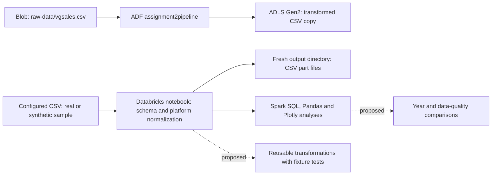

# Video-game sales ETL and visual analysis

## Architecture

Solid arrows show implemented workflows. The ADF copy and notebook run independently; ADF does not launch the notebook. Dotted arrows show proposed extensions.



This coursework contains an Azure Data Factory copy exercise and a Databricks/PySpark analysis notebook for video-game sales. It does not analyse movie data or currently use SQL.

- `assignment2pipeline` copies Blob `raw-data/vgsales.csv` to an ADLS Gen2 `transformed/` folder. It performs CSV copying, not the notebook's transformations.
- `Assignment 2.ipynb` reads a configured CSV, sets a schema, normalizes Atari platform labels, writes CSV output, and produces Plotly charts for genre counts, platform sales, publisher sales, franchise comparisons and regional averages.

These workflows are independent; ADF does not launch the notebook. Do not point their output paths at one another. Genre counts describe representation in the supplied dataset, not popularity across all games; franchise matching is limited to four literal name prefixes.

## Synthetic sample

Start with [examples/vgsales.synthetic.csv](examples/vgsales.synthetic.csv): 12 invented rows matching the notebook's input schema, including Atari labels, missing years and a missing sales value. See [the sample usage guide](examples/README.md) for upload steps, widget paths and expected inspection points. No real dataset or credentials are needed to inspect the sample; executing the notebook still requires Databricks.

## Notebook data and runtime

Use a Databricks Python cluster providing `spark` and `dbutils`, plus Pandas and Plotly. The notebook uses Databricks widgets and cannot execute unchanged in ordinary local Jupyter. No runtime/dependency versions were pinned by the original coursework; choose a supported Databricks runtime, record its bundled versions, and install Pandas/Plotly there if absent.

The CSV header/order must match:

```text
Rank,Name,Platform,Year,Genre,Publisher,NA_Sales,EU_Sales,JP_Sales,Other_Sales,Global_Sales
```

The explicit Spark schema renames the regional sales columns by position to `North_American_Sales`, `European_Sales`, and `Japanese_Sales`. Rank must be numeric; sales must be numeric or empty. Year is retained as text to accommodate missing-year markers. Confirm source licensing and obtain the real dataset yourself; no private data is committed. Double precision is used for analysis, not exact financial accounting.

1. Import `Assignment 2.ipynb` into Databricks.
2. Set `input_csv` and `output_dir` widgets created in the first cell. Their `<INPUT_CSV_PATH>` and `<OUTPUT_DIRECTORY>` defaults are explicit placeholders. Prefer paths under an authorized Unity Catalog Volume, e.g. `/Volumes/<catalog>/<schema>/<volume>/raw-data/vgsales.csv`. Configure storage access through your Databricks administrator/Unity Catalog; no storage keys are embedded in the notebook.
3. Choose a fresh output directory outside the input directory. Writing uses `errorifexists` and stops if output already exists. Spark writes a directory of part files, not one CSV.
4. Run cells in order. Verify source row counts, numeric/null rates, preserved source ranks and normalized Atari labels. Repeat with a new output directory; SQL analysis uses replaceable session views, not persistent tables from a previous run.

The regional-average cell groups game rows before averaging, and the franchise chart mixes game counts and sales units. Their interpretation and improvements are discussed in REVIEW.md. Large collections should be aggregated in Spark before conversion to Pandas.

## Historical ARM export

`assignment-2-akila/` contains the original generated ARM deployment examples, with account/factory identifiers replaced by placeholders. They predate the current source definitions and notebook and are **not** the deployment source of truth. Do not deploy them unchanged. Regenerate an ARM export from the configured current ADF source, then supply deployment parameters securely. No regeneration or Azure deployment has been performed here.

## Configuration and credentials

The committed files are templates. They intentionally contain `<PLACEHOLDER>` markers and cannot run until configured.

1. Open [config/placeholders.json](config/placeholders.json). It indexes each linked service and dataset file to edit. Replace each marker directly in the indicated ADF JSON property, or set that property in ADF Studio. This file is an inventory, not a configuration loader; `.env` files are not read by ADF.
2. Set `linkedService/CourseworkKeyVault.json` → `properties.typeProperties.baseUrl` to your vault URL. For SQL and Blob connection-string services, set `secretName` to an existing secret's **name**. Store its value only in Key Vault. Grant the factory managed identity permission to read those secrets.
3. For `AzureBlobFS` services, replace the `url` storage endpoint. These definitions omit account keys and use the factory system-assigned managed identity. Grant it Storage Blob Data Contributor on the required container and ADLS path ACLs where applicable. Configure SQL/firewall/integration-runtime network access for your resources.
4. Replace dataset `container`/`fileSystem` markers with existing container names. Review folder paths, filenames, SQL schema and table names in `dataset/`; these are input/output contracts, not automatically provisioned resources.
5. If present, `GitHub1` is an unused optional linked service. It is separate from ADF Studio's repository connection and can be removed if unnecessary. To use it, configure its username and Key Vault token-secret name.

The original factory-encrypted credential blobs have been removed. They were tied to the old factory and were not portable credentials. Do not commit keys, passwords, connection-string values, access tokens, or private datasets. `.gitignore` excludes `config/local*`, `.env*`, `data/`, and generated output; ignored files still need secure handling. Configure real values locally or in your private Azure environment, and review changes before committing.

## Develop and validate

Use Python 3.10+ for the dependency-free offline checks, from this repository root:

```sh
python scripts/validate.py
```

This checks resource names/references, copy source/connector consistency, accidental self-copies, credential-blob removal, and notebook Python syntax where present. It does **not** execute ADF expressions, authenticate, check SQL schemas, or prove cloud behavior.

For cloud validation, connect/import these folders in Azure Data Factory Studio, configure the placeholders, use **Validate all**, then debug against a small disposable dataset. Inspect activity status, rows read/written, destination contents and schema. ADF Git integration must point at the branch containing these changes. Use **Publish** only after reviewing the generated deployment changes. There is no local ADF execution engine.

Microsoft's `@microsoft/azure-data-factory-utilities` can provide additional semantic validation; it needs its bundle from `https://adf.azure.com/assets/cmd-api/main.js`. That download was blocked by HTTP 403 in the cloud workspace, so semantic and live-resource validation remain unrun. No deployment was made.

## Review and next steps

See [REVIEW.md](REVIEW.md) for implemented fixes, remaining limitations, and small coursework-sized extensions.
